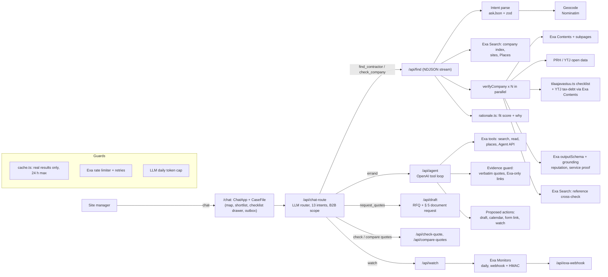

# Kilpi for contractors

Kilpi finds and vets subcontractors for Finnish construction and renovation companies before they sign a subcontract. It covers the checks required by the Contractor's Liability Act (tilaajavastuulaki 1233/2006) and adds what the public registers don't show: references, licences, capacity, news and complaints. Every finding links to its source, and Kilpi asks before it does anything.

Built for the Exa "Internet Butler / Your Personal Assistant" challenge at Junction 2026. Next.js 15, Exa API, OpenAI (`gpt-5.4-mini` by default).

---

## Who it's for

Main contractors, builders and housing-company project managers in Finland who hire subcontractors: electricians, plumbers (LVI), waterproofers, painters, flooring and demolition crews. The typical user is a site manager or purchaser who has a project, a trade to fill and a start date, and no time to check candidates by hand.

## The problem

- **The duty applies widely.** In construction, the duty to check applies to every client, even when building is not their normal business ([Työsuojeluhallinto guide][guide]). It applies to subcontracts of €9,000 or more excluding VAT ([guide][guide]; [Act 1233/2006][law]).
- **The checklist has seven items.** For each subcontractor the client must get: prepayment, employer and VAT register status; a trade register extract; a statement on tax payments; a pension insurance certificate; the applicable collective agreement; proof of occupational health care; and, for construction, proof of statutory accident insurance ([guide][guide], § 5 of [the Act][law]).
- **The documents can't be old.** At signing, no document may be more than three months old ([guide][guide]).
- **Neglect costs money.** A client that neglects the checks can be charged a negligence fee (laiminlyöntimaksu) under [the Act][law]. Kilpi does not state fee amounts, because the code holds no official source for them.
- **There are more duties.** Construction contracts over €15,000 excluding VAT go into the monthly contract-details report to the Tax Administration, and workers on a shared site need a photo ID with their tax number ([Vero][vero-reporting]).
- **Today the checks are manual.** Someone opens YTJ, the tax-debt register and the Tukes register, emails the subcontractor for certificates, then searches for news. That repeats for every candidate and every project.
- **Existing reports cover only some firms.** The guide lets a client rely on a reliable private provider's report ([guide][guide]). The usual one is Vastuu Group's Luotettava Kumppani report, which exists only for companies that joined the programme. Small local subcontractors often haven't. Even with that report, nothing checks the firm's references, licence claims, capacity for a 40-apartment job, or the news.

## What it does

1. **Understand the job.** Kilpi parses a request in English, Finnish or Swedish, for example *"Electrical subcontractor for a 40-apartment pipe renovation (linjasaneeraus) in Espoo, start March"*, into a trade, scope, place, start date and contract value. It tells you whether the Act applies at that value.
2. **Find candidates.** It searches Exa's company index (headcount, revenue, founding year), runs semantic search over Finnish and English company sites that list similar reference projects, and uses Exa Places for local listings. Candidates are ranked local-first, and B2B firms with five or more staff come first.
3. **Vet each candidate** (in parallel, results stream in):
   - **Identity:** the business ID (Y-tunnus) printed on the company's own site, checksum-validated and matched to the open PRH/YTJ register.
   - **Tilaajavastuu registers:** prepayment, employer and VAT registers, the trade register, and insolvency entries, all from PRH open data. Tax debt and missed filings come from the public tax-debt register on the company's YTJ page, read with Exa Contents.
   - **Documents only the subcontractor can give** (pension, collective agreement, occupational health care, accident insurance): these become a document request. Each item names the exact document and its legal basis (e.g. `1233/2006 5 § 4 kohta`).
   - **Capability:** reference projects on the firm's own site, each cross-checked against an independent page found with Exa. Also capacity against the job's size, licence claims (Tukes for electrical work, waterproofer certificates), and certifications.
   - **Reputation:** complaints, bankruptcy, unfinished work and reviews from third-party pages, via Exa structured output with grounding.
4. **Rank and explain.** Each firm gets a 0–100 fit score from the checks. The score comes with 2–4 reasons, and each reason carries the evidence it came from.
5. **Prepare next steps for approval.** Kilpi drafts a quote request (RFQ) and a § 5 document request in Finnish and English, listing only the documents still missing. Drafts go to an outbox and are sent only when the user clicks "Approve and send", which opens their own mail app.
6. **Watch during the project.** If the user approves, Kilpi creates an Exa Monitor that searches daily for news, bankruptcy (konkurssi), restructuring (yrityssaneeraus) or complaints about the subcontractor.
7. **Answer questions and handle tasks.** Questions such as "does tilaajavastuu apply to a €7,000 subcontract?" or "our subcontractor walked off site, what now?" go to an agent that researches with Exa tools. It answers with citations and proposes actions (a draft letter, a calendar deadline, an official form link, a monitor), each one waiting for approval.

Kilpi can also check and compare subcontractor quotes that the user pastes in. The UI is a chat beside a live case file with a map, the shortlist, a tilaajavastuu checklist drawer per candidate, and the outbox.

## Why Exa is essential

None of the information Kilpi relies on is in a model's training data. It changes weekly, and much of it exists only on small Finnish company sites and local news pages. Each Exa product below does a job that nothing else in the stack can do.

| Exa product | Where | Why it's needed |
|---|---|---|
| **Search** (`type: auto`), `userLocation: "FI"`, `includeDomains`/`excludeDomains` | `src/lib/exa.ts` `findSubcontractorsWeb`, `findCompaniesWeb`; `src/lib/verify.ts` | Finds Finnish subcontractor sites by what they did (e.g. *"sähköurakoitsija Espoo referenssit taloyhtiöt"*), not by keyword. Directories and marketplaces are excluded, so only real contractors come back. |
| **Search, `category: "company"`** (company index) | `companyProfile`, `findSubcontractorsWeb` | Headcount, annual revenue and founding year. The Finnish trade register doesn't publish these. They drive the capacity check ("8 staff for a 40-apartment job?"). |
| **Search via Places** (`type: lite`, `userLocation: {country, latitude, longitude}`) | `findPlaces` | Local listings with address, phone and rating around the geocoded site. They fill shortlist slots, and the case-file map uses their coordinates. |
| **Contents with `subpages` + `subpageTarget`**, `livecrawlTimeout` | `fetchSite` in `verify.ts` | Reads the firm's own site, including `/referenssit`, `/yhteystiedot` and certificate pages, in one call. That gives the business ID, contact details, references and licence claims. |
| **Contents on the YTJ company page** | `ytjTaxDebt` in `tilaajavastuu.ts` | YTJ's tax-debt register has no API. Exa's copy of the page has the "Verovelkatieto" lines. The tool links to YTJ for a re-check on signing day. |
| **Search with `outputSchema` (deep-lite) + grounding** | `groundedReputation`, `groundedServiceProof` in `exa-grounded.ts` | Returns structured findings (complaint, bankruptcy, unfinished work) with per-field citations and confidence. Kilpi then fetches each cited page and keeps a quote only if it appears there word for word. |
| **Dynamic highlights** (beta `dynamic-highlights-2026-08-28`) | `searchDynamic` | One character budget shared across results. Pages that actually discuss the company get long passages, and directory pages get little. Falls back to fixed highlights if the beta is unavailable. |
| **Search for independent confirmation** | `confirmReference` | Checks each reference a firm claims against a page on another domain that names both the firm and the project. |
| **Monitors** (`/monitors`, daily interval, webhook with HMAC signature check, `/runs`, delete) | `src/app/api/watch`, `src/lib/agent/monitor.ts`, `src/app/api/exa-webhook` | After signing, keeps watching the subcontractor for konkurssi, yrityssaneeraus, reclamations and news. Combined with Search, it covers the whole contract instead of one day. |
| **Agent API** (`/agent/runs` with `outputSchema`) | `exa_find_list` tool in `src/lib/agent/tools.ts`; `/api/more` | Longer "find all X matching criteria" research when one search isn't enough. Each item returns with a source URL. |
| **Agent Monitors backtest** (beta) and an emulated backtest via `startPublishedDate` | `src/lib/exa-monitor.ts` (classic view) | Shows what a monitor would have caught over the last N days before you turn it on. |
| **Snapshot** (`snapshotAsOf`), opt-in with `EXA_SNAPSHOT=1` | `priceHistory` | Shows whether a price page changed over the past months. Off by default because of trial quota. |
| **Exa Connect (Fiber)**, opt-in with `EXA_CONNECT_FIBER=1` | `exa-agent.ts`, `exa-connect.ts` | Key-contact lookup. Off by default because of cost (about $0.05–0.35 per company, per the code comment). |

**Rate limits and caching.** All Exa calls go through one limiter: by default 8 starts per second and 10 in flight, with 429/5xx retried with backoff. Identical `/search` and `/contents` requests are cached for 1 hour. Candidate discovery for a job+area and LLM intent parses are cached for 6 hours. A company's finished report is served without re-checking for 6 hours. Between 6 and 24 hours old, it is shown at once and then re-checked. Nothing older than 24 hours is ever served. The cache holds only real API results, each stored with the time it was fetched.

## Architecture



## Guards

- **Verbatim quote check.** A quote shown as evidence must appear word for word in text Exa returned: the page, its subpages or a highlight. Otherwise it is dropped. This covers site-profile extraction (`tilaajavastuu.ts` `anchored`), reputation findings (cited pages are re-fetched and compared), service proof, and the agent's answers (`quoteIsVerbatim` in `src/lib/agent/evidence.ts`).
- **Links only from Exa.** The agent's answer goes through `groundText`, which removes citation markers that point to evidence never retrieved, and any URL not in the retrieved evidence. Form and booking links must come from evidence. The UI reports what the guard removed.
- **Approval before any action.** The agent's actions are proposals (`requiresApproval: true`). Emails open the user's mail app (`mailto:`) only after "Approve and send". Calendar entries download as `.ics` files. Monitors are created only through an explicit approve call. The server runs no action on its own except creating a monitor after approval.
- **No dummy data.** There are no seeded companies, quotes or reviews. If nothing is found, the UI says so ("No reviews or news found about this company", grey checks with a document to request). The cache only replays earlier live results, with their timestamps.
- **Law claims carry their source.** Every tilaajavastuu check cites the Työsuojeluhallinto guide with a verbatim Finnish line, the YTJ register page, or the Vero page that requires it, plus the legal basis (`1233/2006 5 § n kohta`).
- **Input checks.** Business IDs are checksum-validated before any lookup. Queries outside Finland are refused, because the registers only cover Finnish firms. Out-of-scope requests are redirected. Web page text is passed to the LLM as untrusted data and never treated as instructions.
- **LLM daily cap.** All OpenAI calls (structured `askJson` and the agent loop) share one daily token budget (`LLM_DAILY_TOKEN_CAP`, default 1,500,000). Usage is saved to the OS temp directory, so a restart doesn't reset the count. When the cap is reached, LLM calls fail fast and `/api/find` falls back to a keyword intent parser.

## Setup

Requires Node 20+.

```bash
cd kilpailutus
npm install
cp .env.example .env.local   # then fill in the values below
```

| Variable | Required | Default | Purpose |
|---|---|---|---|
| `EXA_API_KEY` | yes | — | Exa Search, Contents, Monitors, Agent API |
| `OPENAI_API_KEY` | yes | — | Intent parsing, extraction, router, agent loop |
| `OPENAI_MODEL` | no | `gpt-5.4-mini` | OpenAI model (Responses API). Reasoning effort is sent only to reasoning models |
| `LLM_DAILY_TOKEN_CAP` | no | `1500000` | Hard daily input+output token cap across all LLM calls |
| `PUBLIC_BASE_URL` | no | request origin | Public **https** URL (e.g. a tunnel) so Exa can deliver monitor webhooks. Without it, monitors are polled |
| `KILP_CACHE` | no | on | `0` disables the result cache (every request goes live) |
| `EXA_CONNECT_FIBER` | no | off | `1` lets Agent API runs query Fiber.ai for a key contact. Costs extra per company |
| `EXA_SNAPSHOT` | no | off | `1` enables the price-history check with Exa Snapshot |

Less common: `EXA_CACHE_TTL_MS` (default 1 h), `REPORT_CACHE_TTL_MS` (default 6 h), `KILP_CACHE_FILE`, `EXA_MAX_QPS` (8), `EXA_MAX_INFLIGHT` (10), `EXA_DYNAMIC_HIGHLIGHTS=0`, `EXA_WEBHOOK_SECRETS` (comma list, keeps webhook verification working after a restart), `EXA_CONNECT_BASELAYER`.

## Run

```bash
npm run dev            # http://localhost:3000/chat
# or
npm run build && npm start
```

- `/chat` is the product: Kilpi for contractors (B2B).
- `/` is the earlier "classic" view. It has the raw Exa trace panel (every call, its time and its cache status), the quote checker, the watch panel with backtest, and the Agent API "find more" matrix. It is useful for showing what Exa does under the hood.

## Warm-up before a demo

A first run of a search with 4 candidates makes roughly 20+ Exa calls and takes tens of seconds. Within 6 hours of the demo, run the demo queries once so later runs come from real cached reports:

1. Start the server, open `/chat`, click each demo prompt (see `docs/DEMO-RUNBOOK.md`), and wait for the ranking to finish.
2. Run each one a second time. It should finish in seconds.

The cache is mirrored to `$TMPDIR/kilpailutus-cache/cache-v1.json`, so a server restart keeps it. Warm the demo query before presenting with `node scripts/warm.mjs [baseUrl]`: it sends the `/chat` welcome-chip query with `audience: "b2b"`, the same request the chip makes.

When a result comes from the cache, its age is recorded (`cachedAt` on the report, "cached N min ago" in the Exa trace). The `/chat` view doesn't display this yet, so say it out loud when presenting.

## Limitations

- **Four of the seven § 5 items can't be checked from public data.** These are pension insurance, collective agreement, occupational health care and accident insurance. Kilpi requests these documents but doesn't read or verify what comes back.
- **The tax-debt result may be days old.** Company tax debts in the [tax-debt register][vero-taxdebt] are public, but Kilpi reads them from Exa's copy of the YTJ page, so each check carries a "Re-check in YTJ" link. Sole traders' tax debt is visible only to signed-in users, so Kilpi asks for a certificate instead.
- **Tukes registration and certifications are claims on the firm's own site,** shown with a quote. Kilpi links to the [Tukes register][tukes] but doesn't query it.
- **Reference confirmation is a name match on an independent page.** A same-named firm or a vague page can confirm or miss a reference.
- **Exa company-index figures (headcount, revenue) are not official,** and the index doesn't state the revenue currency.
- **The errand agent's system prompt (`src/lib/agent/loop.ts`) is still worded for household hiring.** The B2B router decides scope first, but answers to B2B questions may be framed in consumer terms or declined. Rehearse the tilaajavastuu question before presenting.
- **Results vary between runs.** Exa deep search and the LLM are sampled. The router rewrites the user's message before the search, so differently worded requests can miss the cache and produce a different shortlist.
- **Monitors need a public https URL for webhooks.** Locally they are polled. Monitor IDs and webhook secrets are kept in memory, so they are lost on restart unless `EXA_WEBHOOK_SECRETS` is set. The case file and chat live in the browser's localStorage, with no accounts and no server-side project store.
- **Finland only.** If no place is given, Kilpi searches around Espoo. Geocoding uses OpenStreetMap Nominatim, limited to 1 request per second.
- **Not legal advice.** Kilpi shows what the official sources say and links to them.

[law]: https://www.finlex.fi/fi/lainsaadanto/2006/1233
[guide]: https://tyosuojelu.fi/documents/154017715/168016298/Tilaajavastuulaki_FI.pdf/e44a5af6-0128-457e-ab25-65c3bcd5b59e/Tilaajavastuulaki_FI.pdf
[vero-reporting]: https://www.vero.fi/en/detailed-guidance/guidance/48413/the-information-reporting-requirement-in-the-construction-industry2/
[vero-taxdebt]: https://www.vero.fi/yritykset-ja-yhteisot/verot-ja-maksut/maksaminen-yritykset-ja-yhteisot/maksuvaikeudet/verovelkarekisteri/
[tukes]: https://rekisterit.tukes.fi/
